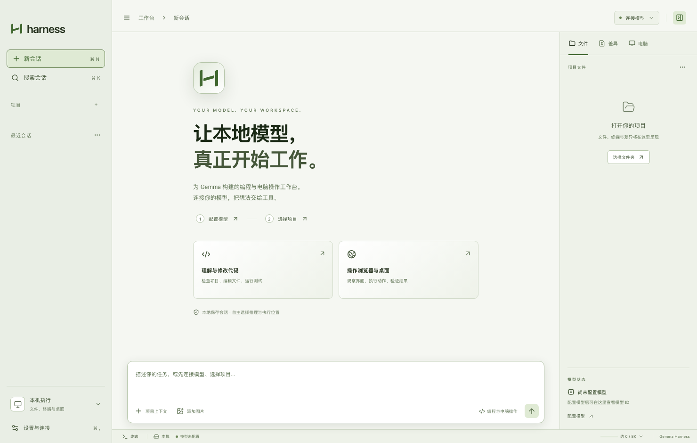

# Gemma Harness

面向本地 Gemma 模型的桌面编程与电脑操作工作台。模型推理和工具执行可以分别放在本机或其他设备上。

*浅色模式主页，空工作区界面预览。*

## 主要功能

- **编程工作台**：对话中读取和修改项目文件、搜索代码、运行命令，并查看工具执行过程与 Git 差异。
- **电脑与浏览器操作**：通过浏览器和原生桌面工具观察界面、执行操作；可添加图片供具备视觉能力的模型使用。
- **灵活连接**：连接 LM Studio、llama.cpp 或兼容的推理服务，也可运行本地 GGUF 模型；支持将任务发送到已配对的执行设备。
- **本地工作区**：管理项目与会话，在本地保存历史，并调整主题、配色和字体。

## Gemma 适配性

Gemma Harness 以 Gemma 为首要适配目标。下表比较各项目公开文档中的模型接入方式，以及本项目面向 Gemma 的区别：

| 对比对象 | 对方的模型接入方式 | Gemma Harness 的区别 |
| --- | --- | --- |
| [Codex](https://learn.chatgpt.com/docs/config-file/config-advanced#oss-mode-local-providers) | 支持通过 `--oss` 使用 Ollama 或 LM Studio，也可配置其他模型服务；具体模型能否正常工作取决于服务和模型。 | 可选择 Gemma 4、Gemma 3 或 FunctionGemma 系列及推理后端；针对 FunctionGemma 解析原生函数格式，并在执行前校验工具参数。 |
| [DeepSeek Harness](https://deepseek-harness.github.io/deepseek-harness/guide/providers) | 支持自建服务及 OpenAI Chat Completions、Responses 等自定义 API，可配置模型的图片输入类型。 | 提供可管理的本地 llama.cpp 和 GGUF 模型接入；分别诊断图片输入与图片工具结果，未通过诊断时不向模型发送图片。 |
| [Claude Code](https://code.claude.com/docs/en/llm-gateway) | 官方主要面向 Claude；Anthropic 不支持通过网关将 Claude Code 路由到非 Claude 模型。 | 面向 Gemma 直接连接 LM Studio 或 llama.cpp；在 Gemma 4 与 llama.cpp 的 Chat Completions 组合下提供思考模式开关。 |

这些区别描述的是模型接入与适配设计，不代表其他工具没有类似能力，也不代表本项目的任务效果更好。目前没有使用相同模型、推理服务和任务集进行横向对照；具体表现取决于权重、量化、模板和运行环境。实测范围和局限见 [Gemma 适配与验证](docs/gemma-adaptation.md)。
