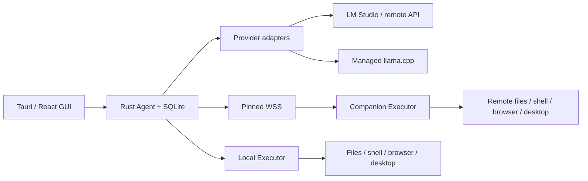

# Architecture and invariants

The Tauri WebView is a presentation client. All network credentials, model requests, file/tool effects and process management live in Rust. `command` is the request/response IPC route; `stream_turn` uses Tauri Channel for per-turn events. Remote web pages have no IPC capabilities.

## Model and tools

- Chat Completions and Responses use separate wire encoders and event normalizers. SSE is decoded from bytes, preserving fragmented Unicode.
- The inference server owns the Gemma chat template. FunctionGemma has a bounded native function-call parser and, for llama.cpp, argument serialization for the server's native function syntax; canonical stored messages remain JSON. Nullable JSON Schema is lowered only for transport when unambiguous; execution validates the full original schema.
- A complete stream, recognized tool name, valid object arguments and full-batch schema validation are required before effects. Truncated or disconnected streams cannot release buffered tool calls. A fully received invalid batch is rejected as a whole and gets at most one consecutive correction attempt with specific feedback; an unknown tool never releases valid siblings.
- Simple coding tools are available initially. Browser, desktop and MCP schemas load through `tool_search`; MCP discovery is lazy, limited to five seconds per server, and incompatible schemas are reported without disabling other tools. Results are paged; at most six optional tools replace the previously loaded optional group. Exact names and MCP descriptions are searchable.
- One generation runs per normalized server origin at a time, including chat, summaries and diagnostics; common loopback spellings share the gate. Tools release the inference permit. Queue waits and diagnostics can be cancelled. A turn has a 48-step upper bound. Identical failed calls stop after three failures; explicit successful file edits reset that guard.
- `reasoning_content` remains available within the current tool cycle; raw reasoning from prior user turns is not replayed.
- Explicit Gemma 4 thinking control is sent only to llama.cpp Chat Completions; `auto` leaves the backend's default in charge. Diagnostics report configured family/backend and observed behavior separately; model-name inference is not weight verification.

## Persistence and context

SQLite stores immutable message/activity events. A compaction event records a new request projection without deleting source evidence. Missing tool results are repaired **in their original call block** with an explicit indeterminate result; recovery never replays their side effects.

Prompt estimation includes tool schemas, the configured output reserve and a safety margin. Near the budget, a text-only llama.cpp Chat Completions request can use the backend's rendered template and tokenizer if exactly one reported model matches the selection; otherwise it falls back to a labeled estimate. Binary image payloads are excluded from text estimation and assigned a visual allowance. The original user request is pinned verbatim without duplication while present in the projection, with later user corrections taking precedence. Summaries retain recent complete tool cycles; boundaries never separate calls from results. `history_search` retrieves bounded original evidence after compaction. Summary generation is lossy and is not claimed to preserve every past sentence exactly.

The model projection reads only the latest compaction checkpoint and subsequent messages in SQLite. Summaries receive valid JSON with head/tail excerpts, not a truncated JSON prefix; their complete input is checked against the calibrated budget. Backend usage can increase the conservative estimate within a turn. Large results keep valid JSON metadata and expose complete saved text through UTF-8-safe artifact pages. Streamed answers interrupted by failure are retained as partial activity, not replayed as completed assistant messages.

User and tool images are archived before vision gating, and the model projection retains pixels for at most the latest two images. A managed-engine restart invalidates its vision diagnosis. External endpoints are rechecked before the first image transmission of a turn because the model behind an alias may change; failed checks preserve the local artifact, mark the diagnosis unknown and prevent image transmission. The probes test color quadrants and the tool-result path, not general visual accuracy.

## Execution and cancellation

The selected execution device interprets workspace paths. A remote session must match the Companion's canonical shared directory; every remote dispatch checks the binding again. File API confines canonical paths and checks the expected SHA256 for replacement, either directly or through an in-memory read token bound to the canonical path and hash. When a model omits both version fields, the agent may reuse only a token actually read for that path in the current turn; effective arguments and their origin are recorded, and the executor still verifies the hash. A write with no version and no same-turn read is create-only, published through a no-overwrite hard link; unsupported filesystems fail safely. Tokens expire on restart or eviction and do not waive the version check. Arbitrary shell is not a filesystem sandbox.

Desktop ownership is held by a session and renewed during slow inference. Remote operations additionally require the host's authenticated pairing/session lease. Manual previews use separate transient session IDs and release ownership even on failure. OS input already delivered cannot be undone by cancellation.

The browser and native helpers use bounded, versioned JSONL messages in child processes. They cannot fabricate successful observations when permissions or runtime components are absent.

Worker and MCP writes, flushes and reads are covered by cancellation and deadlines; framing limits apply during reading. Failed transports are reaped and discarded. If an effectful request may already have been sent, loss of its reply is indeterminate, including local actions and MCP calls; the remaining batch stops. Process exit status and output-capture completeness are reported separately, including received/saved byte counts and whether an output artifact hit its size limit.

GUI stream updates are batched and historical cards memoized. Closed tool details are rendered lazily, and the initial activity window is bounded for DOM work. Source events are still loaded in full when opening a GUI session; this is not a bound on complete-session memory. Metrics distinguish estimated context from backend usage, and end-to-end request throughput from pure decode speed.

Appearance preferences use a separate persistence route, allowing preview/save without cancelling work or replacing conversation state. Settings owns the live preview until save/cancel; unrelated snapshots do not override it. UI and code fonts are local font stacks.

Projects are independent SQLite bookmarks keyed by device and workspace, migrated once from legacy configuration/history. Renaming changes only a display alias; removal preserves files and historical session bindings. Registry/config changes commit atomically. A binding gate serializes project/settings changes with operation admission, including manual tools; active work prevents project switching/removal while display-name edits remain available.

## API additions

- `ConnectionConfig`, `ModelProvider` events, canonical messages and calls are independent of GUI and tool execution.
- Executor provides `execute`, `capabilities`, `setup_browser` and a tool schema registry.
- Companion provides protocol negotiation, capabilities, operation execute/status/cancel, event cursor replay, artifact fetch and desktop lease acquire/renew/release.
- Host pairing credentials and model keys go into the OS credential store. SQLite/config JSON do not contain them.
