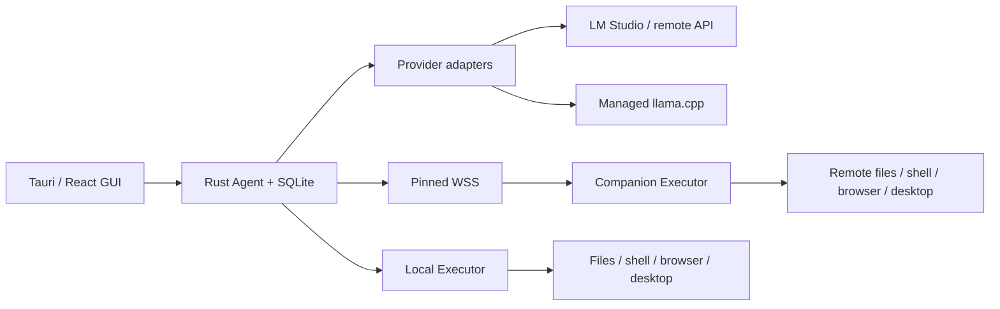

# Architecture and invariants

The Tauri WebView is a presentation client. All network credentials, model requests, file/tool effects and process management live in Rust. `command` is the request/response IPC route; `stream_turn` uses Tauri Channel for per-turn events. Remote web pages have no IPC capabilities.

## Model and tools

- Chat Completions and Responses use separate wire encoders and event normalizers. SSE is decoded from bytes, preserving fragmented Unicode.
- The inference server owns the Gemma chat template. Simple Gemma 4 wire projections place images before text; interleaved captions and canonical history retain their order. FunctionGemma has a bounded native function-call parser and, for llama.cpp, argument serialization for the server's native function syntax; canonical stored calls remain JSON. Encoded JSON arguments reject duplicate object keys. Nullable JSON Schema is lowered only for transport when unambiguous; execution validates the full original schema and action-specific requirements.
- A complete stream, recognized tool name, valid object arguments and full-batch schema validation are required before effects. Truncated or disconnected streams cannot release buffered tool calls. A fully received invalid batch is rejected as a whole and gets at most one consecutive correction attempt with specific feedback; an unknown tool never releases valid siblings.
- Common file tools are available initially. Large-file chunk reads, file inspection, deleted-file restoration, browser, desktop and MCP schemas load through `tool_search` to preserve the model's context budget; MCP discovery is lazy, limited to five seconds per server, and incompatible schemas are reported without disabling other tools. Results are paged; at most six optional tools are loaded. A caller can retain up to five currently loaded names while searching another page. Exact names and MCP descriptions are searchable.
- One generation runs per normalized server origin at a time, including chat, summaries and diagnostics; common loopback spellings share the gate. Tools release the inference permit. Queue waits and diagnostics can be cancelled. A turn has a 48-step upper bound. Identical failed calls stop after three failures; explicit successful file edits reset that guard. Three unchanged consecutive read-only observations produce advice without blocking intentional polling.
- `reasoning_content` remains available within the current tool cycle; raw reasoning from prior user turns is not replayed.
- Explicit Gemma 4 thinking control is sent only to llama.cpp Chat Completions; `auto` leaves the backend's default in charge. Configurable sampling values are requests, not verification of an opaque server's effective settings. A Gemma 4 thinking generation that reaches its automatic output limit without visible text or emitted tools may retry once with a larger bounded reserve; explicit user limits are not overridden. Diagnostics report family provenance/backend and observed behavior separately; names and GGUF metadata do not verify weights.

## Persistence and context

SQLite stores immutable message/activity events. A compaction event records a new request projection without deleting source evidence. Missing tool results are repaired **in their original call block** with an explicit indeterminate result; recovery never replays their side effects.

Prompt estimation includes tool schemas, the configured output reserve and a safety margin. Near the budget, a text-only llama.cpp Chat Completions request can use the backend's rendered template and tokenizer if exactly one reported model matches the selection; otherwise it falls back to a labeled estimate. A smaller safety margin is used only for that measured text prompt. Binary image payloads are excluded from text estimation and assigned a visual allowance. Compaction and overflow recovery retain omitted original user messages in order at user priority, separate from the lossy work summary; when their bounded ledger cannot fit, the turn stops instead of silently discarding constraints. Later explicit corrections supersede older instructions. Boundaries never separate calls from results. `history_search` retrieves bounded original evidence after compaction and uses Unicode-aware lowercasing.

The model projection reads only the latest compaction checkpoint and subsequent messages in SQLite. Summaries receive valid JSON with head/tail excerpts, not a truncated JSON prefix; their complete input is checked against the calibrated budget. Backend usage can increase the conservative estimate within a turn. Large results keep valid JSON metadata and expose complete saved text through UTF-8-safe artifact pages. Streamed answers interrupted by failure are retained as partial activity, not replayed as completed assistant messages.

User and tool images are archived before vision gating, and the model projection retains pixels for at most the latest two images. Explicit references to a previous image can restore the latest content-addressed image artifacts, subject to the same vision gate and an 8 MiB total bound. A managed-engine restart invalidates its vision diagnosis. External endpoints are rechecked before the first image transmission of a turn because the model behind an alias may change; a semantic probe failure receives one bounded retry, while failed checks preserve the artifact, mark diagnosis unknown and prevent image transmission. The probes test color quadrants and the tool-result path, not general visual accuracy.

`file_search` streams UTF-8 files up to 64 MiB with bounded line memory; oversized files, lines, invalid text, read errors and search limits are reflected in `complete` and skipped-path metadata. A missing match is conclusive only within the reported scope when `complete` is true. For short Gemma 4 `file_read` calls with explicit `raw:true`, the model receives the exact text directly; complete metadata remains in the activity log and the same-turn read token remains bound and verified for edits. Default reads retain the line-numbered view after a small E2B comparison found editing regressions with automatic raw projection.

## Execution and cancellation

The selected execution device interprets workspace paths. A remote session must match the Companion's canonical shared directory; every remote dispatch checks the binding again. File API confines canonical paths and checks the expected SHA256 for replacement, either directly or through an in-memory read token bound to the canonical path and hash. When a model omits both version fields, the agent may reuse only a token obtained for that path in the current turn: inspection is sufficient for deletion, a partial read for an exact patch, and a complete delivered read for a whole-file replacement. Effective arguments and their origin are recorded, and the executor still verifies the hash. A write with no version and no same-turn complete read is create-only, published through a no-overwrite hard link; unsupported filesystems fail safely. Tokens expire on restart or eviction and do not waive the version check. Arbitrary shell is not a filesystem sandbox.

Ordinary text reads are limited to 2 MiB; the optional chunk reader supports larger files and base64-encoded binary data, with byte offsets and a version token. When a result must be shortened to fit the model context, its next offset describes exactly the bytes actually delivered. File writes and exact patches are limited to 16 MiB per file; writes also accept base64. An inspection or partial chunk can authorize a checked deletion, but is not treated as a complete read that implicitly authorizes overwriting a file.

Deletion applies to regular files, not directories or final symbolic links, and requires the inspected version. It first saves a private, checksummed backup and metadata in the executor's artifact store; failure to save the backup prevents deletion. The session UI can restore a deletion using its recorded successful operation on the original device, without trusting a path supplied by the UI. Restore checks the backup and publishes via a no-overwrite hard link; filesystems without hard-link support fail safely. Backups consume space equal to the deleted files and remain subject to the artifact store's lifecycle. Version checks reduce accidental races, but a concurrent change between the final check and filesystem removal cannot be made atomic on every platform.

Desktop ownership is held by a session and renewed during slow inference. Remote operations additionally require the host's authenticated pairing/session lease. Manual previews use separate transient session IDs and release ownership even on failure. OS input already delivered cannot be undone by cancellation.

The browser and native helpers use bounded, versioned JSONL messages in child processes. They cannot fabricate successful observations when permissions or runtime components are absent.

Worker and MCP writes, flushes and reads are covered by cancellation and deadlines; framing limits apply during reading. Failed transports are reaped and discarded. If an effectful request may already have been sent, loss of its reply is indeterminate, including local actions and MCP calls; the remaining batch stops. Process exit status and output-capture completeness are reported separately, including received/saved byte counts and whether an output artifact hit its size limit.

GUI stream updates are batched and historical cards memoized. Closed tool details are rendered lazily, and the initial activity window is bounded for DOM work. Source events are still loaded in full when opening a GUI session; this is not a bound on complete-session memory. Metrics distinguish estimated context from backend usage, and end-to-end request throughput from pure decode speed.

Appearance preferences use a separate persistence route, allowing preview/save without cancelling work or replacing conversation state. Settings owns the live preview until save/cancel; unrelated snapshots do not override it. UI and code fonts are local font stacks.

Projects are independent SQLite bookmarks keyed by device and workspace, migrated once from legacy configuration/history. Renaming changes only a display alias; removal preserves files and historical session bindings. Registry/config changes commit atomically. A binding gate serializes project/settings changes with operation admission, including manual tools; active work prevents project switching/removal while display-name edits remain available.

## API additions

- `ConnectionConfig`, `ModelProvider` events, canonical messages and calls are independent of GUI and tool execution.
- Executor provides `execute`, `capabilities`, `setup_browser` and a tool schema registry.
- Companion provides protocol negotiation, capabilities, operation execute/status/cancel, event cursor replay, artifact fetch and desktop lease acquire/renew/release.
- Host pairing credentials and model keys go into the OS credential store. SQLite/config JSON do not contain them.
